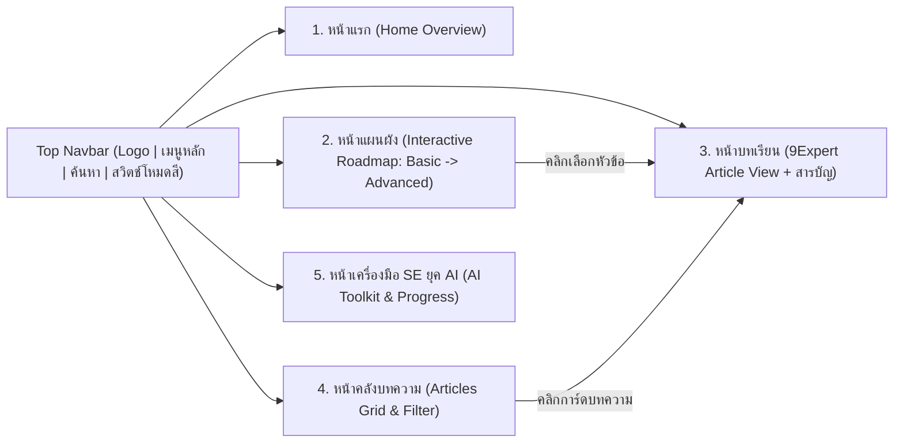

# UI/UX Design Specification: LernWeb (9Expert-Inspired Design System)

เอกสารนี้กำหนดแนวทางการออกแบบหน้าตาเว็บไซต์ (UI) และประสบการณ์ผู้ใช้งาน (UX) ของแพลตฟอร์ม **LernWeb — Roadmap ความรู้สำหรับ Software Engineer ในยุค AI** โดยอ้างอิงโครงสร้างและเอกลักษณ์ความสะอาดตาจากเว็บไซต์ต้นแบบ **9Expert**

---

## 1. แนวคิดการออกแบบหลัก (Design Philosophy)
1. **Clean & Editorial Clarity (สะอาดตา อ่านง่ายเหมือนเว็บไซต์ความรู้ชั้นนำ):** ใช้พื้นที่ว่าง (Whitespace) อย่างเหมาะสม พื้นหลังสีขาวสะอาดในโหมดปกติ เพื่อให้ผู้อ่านโฟกัสกับเนื้อหาเทคนิคและแผนภาพได้โดยไม่ล้าสายตา
2. **Visual Banner Anchoring (แบนเนอร์กราฟิกสร้างความเข้าใจตั้งแต่แรกเห็น):** ทุกบทเรียนจะมี **Hero Banner โทนสีน้ำเงินเข้ม (`Deep Navy Tech Banner`)** ที่มีชื่อเรื่องเน้นสีชัดเจน (ส้ม/เขียว/ขาว) พร้อมภาพกราฟิกแนว Isometric / Tech Diagram เหมือนต้นแบบของ 9Expert
3. **Effortless Navigation (นำทางง่าย ไม่หลงตำแหน่ง):**
   - มีแถบเมนูด้านบนสุด (Sticky Top Navbar) พร้อมปุ่มค้นหาและสวิตช์สลับโหมดสี
   - ในหน้าบทเรียนมี **กล่อง `สารบัญ` (Sticky Table of Contents)** ด้านขวาที่เลื่อนตามหน้าจอและบอกตำแหน่งหัวข้อที่กำลังอ่านอยู่เสมอ
4. **Progressive Learning Flow (เห็นลำดับขั้นชัดเจน):** ใช้ระบบสีและป้ายกำกับ (Badge) แยกแยะระดับความรู้ **Basic (สีเขียว)** -> **Intermediate (สีฟ้า/น้ำเงิน)** -> **Advanced (สีส้ม/ม่วง)** ในทุกหน้า

5. **Human-made, Not AI-looking (ดูเป็นงานคนทำ ไม่ใช่เทมเพลต AI):**
   - **ห้าม:** emoji เป็นไอคอน, รูปหุ่นยนต์/สมองกล, gradient เรืองแสง/นีออน, เงาฟุ้ง, animation ลอยไปมา, เคอร์เซอร์พิมพ์อัตโนมัติ, grid การ์ดไอคอน 4 ใบ, ป้าย eyebrow ภาษาอังกฤษตัวใหญ่ (เช่น "WHY IT MATTERS")
   - **ใช้แทน:** layout แบบนิตยสาร/เอกสาร (รายการมีเลขลำดับ, ตาราง, syllabus list), เส้นขอบบางๆ, มุมโค้งเล็ก (`6–8px`), สีพื้นเรียบ, ไอคอน SVG เส้นบางเท่าที่จำเป็น
   - **ภาษา:** เขียนเหมือนรุ่นพี่อธิบายให้รุ่นน้องฟัง เป็นกันเอง ไม่ใช้สโลแกนหรือคำโฆษณาเกินจริง
   - **ภาพประกอบ:** ใช้ของจริงในงาน เช่น หน้าจอ code review, diagram เรียบๆ แทนภาพ AI

---

## 2. ระบบสี (Color Palette & Theme Tokens)

รองรับการสลับโหมด **Light Mode (ค่าเริ่มต้นตามภาพต้นแบบ 9Expert)** และ **Dark Mode** ผ่านสวิตช์บนแถบเมนูด้านบนขวา:

### 2.1 Light Mode (Default — 9Expert Style)
| บทบาท (Role) | ชื่อตัวแปร CSS | ค่าสี (Hex) | การนำไปใช้งาน |
| :--- | :--- | :--- | :--- |
| **Page Background** | `--bg-primary` | `#FFFFFF` | พื้นหลังหลักของหน้าบทความและหน้าเว็บ |
| **Subtle Surface** | `--bg-secondary` | `#F8FAFC` | พื้นหลังส่วนคั่น, กล่องโค้ด, และพื้นหลังการ์ดรอง |
| **Card / TOC Surface** | `--bg-surface` | `#FFFFFF` | พื้นหลังกล่อง `สารบัญ` และการ์ดบทเรียน |
| **Primary Brand Blue** | `--brand-primary` | `#1E62D0` | สีโลโก้, ลิงก์ `< กลับไปยังบทความทั้งหมด`, ปุ่มหลัก, และปุ่มลอยมุมขวาล่าง |
| **Banner Deep Navy** | `--banner-bg-start` / `end` | `#08203E` -> `#041022` | พื้นหลังแบนเนอร์หัวข้อบทเรียน (Hero Graphic Card) |
| **Banner Accent Orange** | `--accent-orange` | `#F59E0B` | สีเน้นคำสำคัญบนแบนเนอร์ (เช่นคำว่า `LLM`) และป้ายระดับ Advanced |
| **Banner Accent Mint** | `--accent-mint` | `#4ADE80` | สีเน้นคำรองบนแบนเนอร์ (เช่น `Large Language Model`) และป้ายระดับ Basic |
| **Text Primary** | `--text-primary` | `#111827` | สีหัวข้อหลัก (`H1`, `H2`) และเนื้อหาบทความ |
| **Text Secondary** | `--text-secondary` | `#4B5563` | สีข้อความอธิบายรอง และลิงก์ในกล่องสารบัญ |
| **Text Muted** | `--text-muted` | `#9CA3AF` | เครดิตผู้เขียน (`บทความโดย: ...`) และข้อมูลเวลาอ่าน |
| **Border Subtle** | `--border-color` | `#E5E7EB` | เส้นขอบการ์ดสารบัญ (`1px solid #E5E7EB`) และเส้นคั่นแถบเมนูบน |

### 2.2 Dark Mode (เมื่อเปิดสวิตช์มุมขวาบน)
| บทบาท (Role) | ชื่อตัวแปร CSS | ค่าสี (Hex) | การนำไปใช้งาน |
| :--- | :--- | :--- | :--- |
| **Page Background** | `--bg-primary` | `#0B0F19` | พื้นหลังหลักโทนมืดสบายตาสำหรับนักพัฒนา |
| **Subtle Surface** | `--bg-secondary` | `#111827` | พื้นหลังส่วนรองและบล็อกโค้ด |
| **Card / TOC Surface** | `--bg-surface` | `#1E293B` | พื้นหลังกล่องสารบัญและการ์ดในโหมดมืด |
| **Primary Brand Blue** | `--brand-primary` | `#3B82F6` | สีลิงก์และปุ่มหลักในโหมดมืด |
| **Text Primary** | `--text-primary` | `#F9FAFB` | สีตัวอักษรหลักในโหมดมืด |
| **Text Secondary** | `--text-secondary` | `#9CA3AF` | สีตัวอักษรรองและรายการสารบัญ |
| **Border Subtle** | `--border-color` | `#334155` | เส้นขอบการ์ดและตารางในโหมดมืด |

### 2.3 สีประจำระดับความรู้ใน Roadmap (Level Semantic Colors)
- 🟢 **Basic (ปูพื้นฐาน):** `#10B981` (Emerald Green) — พื้นหลังป้าย `#ECFDF5`
- 🔵 **Intermediate (ระดับกลาง):** `#2563EB` (Royal Blue) — พื้นหลังป้าย `#EFF6FF`
- 🟠 **Advanced (ระดับสูง & AI Engineering):** `#F59E0B` (Amber Orange) — พื้นหลังป้าย `#FFFBEB`

---

## 3. ระบบตัวอักษร (Typography)
- **ฟอนต์หลัก (Thai + English UI & Headings):** `'Prompt'`, `'Anuphan'`, `'Inter'`, sans-serif — ให้ความรู้สึกทันสมัยเหมือนเว็บเทคโนโลยีและสถาบันอบรมชั้นนำ
- **ฟอนต์เนื้อหาบทความยาว (Body Copy):** `'Sarabun'` หรือ `'Anuphan'` ขนาด `16px - 17px` ระยะห่างบรรทัด (`line-height: 1.75`) เพื่อให้อ่านเนื้อหาภาษาไทยผสมศัพท์เทคนิคภาษาอังกฤษได้ลื่นไหล
- **ฟอนต์สำหรับโค้ดและคำสั่ง (Monospace):** `'JetBrains Mono'`, `'Fira Code'`, monospace
- **ลำดับขนาดตัวอักษร (Type Scale):**
  - **Article Title (H1):** `28px - 32px` (`font-weight: 700`, สีเข้มชัดเจนเหมือนหัวข้อ *"Large Language Model (LLM) คืออะไร?..."* ในภาพต้นแบบ)
  - **Section Heading (H2):** `22px - 24px` (`font-weight: 600`, มี `scroll-margin-top: 90px` เพื่อรองรับการกดข้ามจากสารบัญ)
  - **Sub-section Heading (H3):** `18px - 20px` (`font-weight: 600`)
  - **TOC Item (รายการในสารบัญ):** `14px` (`line-height: 1.5`, ระยะห่างระหว่างหัวข้อ `10px`)

---

## 4. การออกแบบโครงสร้างแต่ละหน้า (Page-by-Page UI Blueprints)



---

### 4.1 ส่วนประกอบใช้ร่วมกันทุกหน้า: Top Navigation Bar (ถอดแบบจาก 9Expert)
- **ความสูง:** `72px`, พื้นหลังขาวโปร่งแสงเล็กน้อยพร้อม `backdrop-filter: blur(8px)`, เส้นขอบล่างบางๆ `1px solid var(--border-color)`
- **ฝั่งซ้าย:** โลโก้ **`9LernWeb`** หรือ **`LernWeb SE`** ใช้ไอคอนเกียร์/สมองกลสีน้ำเงินคู่กับฟอนต์สะอาดตา
- **ตรงกลาง (เมนูนำทาง):**
  - `หลักสูตร Roadmap ▾` (Dropdown เลือกข้ามไประดับ Basic, Intermediate, Advanced)
  - `แผนผังการเรียนรู้` (ลิงก์ไปหน้า Interactive Roadmap)
  - `บทความทั้งหมด` (ลิงก์ไปหน้ารวมบทความ)
  - `AI SE Toolkit ▾` (เทมเพลต `context.md`/`Design.md`/`backlog.md` & เช็กลิสต์ตรวจโค้ด AI)
  - `เช็คความก้าวหน้า` (ดูเปอร์เซ็นต์การเรียน)
- **ฝั่งขวา:**
  - ปุ่มแว่นขยายค้นหาด่วน (`🔍`) เมื่อคลิกจะเปิดกล่องค้นหาบทเรียนทันที
  - **Theme Toggle Switch:** ปุ่มสวิตช์ทรงแคปซูลสีฟ้าอ่อน (`#93C5FD`) พร้อมไอคอนพระอาทิตย์สีขาว (`☀️`) / พระจันทร์ (`🌙`) เหมือนมุมขวาบนของภาพต้นแบบ 9Expert

---

### 4.2 หน้า 1: หน้าแรก (Home / Landing Page)
ออกแบบให้ผู้เข้ามาใช้งานครั้งแรกเข้าใจทันทีว่าเว็บนี้คืออะไร และควรเริ่มเรียนจากตรงไหน:
1. **Hero Section — เกริ่นยุค AI (โทนเรียบ ไม่ขายของ):**
   - บรรทัดเล็กด้านบน (สีเทา): "คู่มือพื้นฐานสำหรับคนที่อยากเป็น Software Engineer"
   - หัวข้อใหญ่: **"AI เขียนโค้ดให้เราได้แล้ว แต่คนที่ต้องเข้าใจว่ามันถูกหรือผิด ยังเป็นเรา"**
   - คำอธิบาย 2 ย่อหน้า: AI เขียนโค้ดได้เกือบทุกอย่าง แต่เวลาโค้ดพัง/ช้า/มีช่องโหว่ AI ไม่ได้รับผิดชอบแทนเรา → เว็บนี้รวบรวมพื้นฐานเรียงจากง่ายไปยาก
   - ปุ่มหลัก `เริ่มจากบทแรก` + ลิงก์ข้อความ `ดู Roadmap ทั้งหมด →`
   - **ภาพประกอบฝั่งขวา:** หน้าจอ Pull Request แบบ GitHub ธรรมดา แสดงโค้ด login ที่มีบรรทัด SQL Injection ไฮไลต์แดงอ่อน + คอมเมนต์จาก reviewer ("พี่ต้น") ชี้ปัญหา + หมายเหตุว่าโค้ดนี้ generate มาจาก AI
1.1 **ทำไมยังต้องเรียนพื้นฐาน:** layout 2 คอลัมน์ (หัวข้อซ้าย / รายการเลข 01–04 ขวา คั่นด้วยเส้นบาง) — สั่งงานได้ดีต้องรู้ก่อนว่าจะสั่งอะไร · อ่านโค้ดแล้วรู้ว่ามีปัญหาตรงไหน · แก้ปัญหาเองได้เมื่อ AI วนอยู่ที่เดิม · มองภาพรวมของระบบ
1.2 **แบ่งงานกันให้ชัด:** ตาราง 2 คอลัมน์ธรรมดา "ให้ AI ช่วยได้" vs "ควรเข้าใจเอง"
1.3 **เส้นทางการเรียน:** 3 กล่องแบบ syllabus (ระดับ 1–3) แต่ละกล่องเป็นรายการบท 01–12 มีเครื่องหมาย ✓ บทที่เรียนแล้ว
1.4 **บทความล่าสุด:** การ์ดแบนเนอร์น้ำเงินเข้มสไตล์ 9Expert (ไม่มีภาพ AI) + ระดับ/เวลาอ่าน + ชื่อบทความ
1.5 **Footer:** โลโก้ คำอธิบายสั้น และลิงก์ 2 คอลัมน์
- **Mockup อ้างอิง:** `home_mockup.html` v2 (Static prototype สำหรับรีวิวก่อนพัฒนาจริง)

---

### 4.3 หน้า 2: หน้าแผนผังการเรียนรู้ (Interactive Roadmap Page)
ออกแบบเป็น **Visual Step-by-Step Roadmap** ที่ชัดเจนและกดโต้ตอบได้:
1. **Roadmap Header & Progress Summary:**
   - แสดงหลอดความคืบหน้ารวม (เช่น `เรียนจบแล้ว 3 / 12 บทเรียน (25%)`)
   - ปุ่มกรองระดับ: `[ทั้งหมด]` `[🟢 Basic]` `[🔵 Intermediate]` `[🟠 Advanced]`
2. **Timeline / Step Cards (เรียงจากข้อ 1 ถึง 12):**
   - แบ่งกลุ่มตามระดับ **Level 1: Basic**, **Level 2: Intermediate**, **Level 3: Advanced**
   - แต่ละโหนด (Node Card) แสดง:
     - หมายเลขลำดับขั้น (เช่น `Step 01`, `Step 09`)
     - ป้ายระดับความยากและหมวดหมู่ (เช่น `Advanced • Generative AI`)
     - ชื่อบทเรียนและคำอธิบายสั้นๆ ว่าทำไมเรื่องนี้จึงจำเป็นต้องรู้
     - รายการหัวข้อย่อยที่จะได้เรียน (3-4 หัวข้อ)
     - ปุ่มสถานะ: `เริ่มเรียนเนื้อหานี้ ->` หรือป้าย `✓ เรียนจบแล้ว`
   - มีเส้นเชื่อมโยง (Connector Line) แสดงลำดับก่อน-หลังอย่างชัดเจน

---

### 4.4 หน้า 3: หน้าเนื้อหาบทเรียน (Lesson Detail Page — อ้างอิงภาพ 9Expert 100%)
หน้านี้คือหัวใจสำคัญของการเรียนรู้ ออกแบบตามภาพตัวอย่างของ **9Expert** ทุกองค์ประกอบ:

```
+-----------------------------------------------------------------------------------+
| [Logo: LernWeb]     หลักสูตร v   แผนผัง Roadmap   บทความ   AI Toolkit     [🔍] [☀️] |
+-----------------------------------------------------------------------------------+
|                                                                                   |
|   < กลับไปยังบทความทั้งหมด / Roadmap                                                |
|                                                                                   |
|   +---------------------------------------------------+   +-------------------+   |
|   | [Badge: Generative AI]                  [LernWeb] |   | สารบัญ             |   |
|   |                                                   |   |                   |   |
|   |   LLM                                  [3D Tech]  |   | Large Language    |   |
|   |   Large Language Model                 [Graphic]  |   | Model คืออะไร      |   |
|   |   คืออะไร? ช่วยในงานพัฒนาซอฟต์แวร์ได้อย่างไร           |   |                   |   |
|   |                                                   |   | LLM ทำงานอย่างไร?  |   |
|   | บทความโดย: LernWeb Training    Never Stop Learning |   |                   |   |
|   +---------------------------------------------------+   | ตัวอย่างการใช้งาน    |   |
|   บทความโดย: LernWeb Team • ระดับ: Advanced • อ่าน 10 นาที  |   └ เกี่ยวข้องกับ SE |   |
|                                                           |     อย่างไร?       |   |
|   Large Language Model (LLM) คืออะไร? ทำไม                 |                   |   |
|   Software Engineer และธุรกิจยุคใหม่ต้องเข้าใจ                | กรณีศึกษาจริง       |   |
|   -----------------------------------------------------   +-------------------+   |
|   [เนื้อหาบทเรียนแบ่งตามหัวข้อ H2, H3 พร้อมแผนภาพจำลอง,                              |
|    ตารางเปรียบเทียบ, ตัวอย่างโค้ด/Prompt และแบบฝึกหัดท้ายบท]                   (🔵)  |
+-----------------------------------------------------------------------------------+
```

#### รายละเอียดองค์ประกอบในหน้าบทเรียน:
1. **Top Back Link:**
   - ข้อความ `< กลับไปยังบทความทั้งหมด` สีน้ำเงิน (`#1E62D0`) คลิกเพื่อกลับไปหน้ารวมบทความหรือหน้า Roadmap
2. **Main Container (`max-width: 1180px`, กึ่งกลางหน้าจอ):**
   - ใช้ CSS Grid แบ่งเป็น 2 คอลัมน์: `grid-template-columns: minmax(0, 1fr) 310px` ระยะห่าง (`gap: 36px`)
3. **Hero Banner Graphic Card (ด้านบนของคอลัมน์ซ้าย):**
   - กรอบสี่เหลี่ยมผืนผ้าอัตราส่วนใกล้เคียง `16:9` ขอบมน `border-radius: 16px`
   - พื้นหลังไล่เฉดสีน้ำเงินเข้ม (`linear-gradient(135deg, #061A3A 0%, #0A2E5C 60%, #041226 100%)`) พร้อมลวดลายจุดตารางเทคโนโลยีจางๆ (Tech Grid Pattern)
   - **มุมซ้ายบน:** ป้ายแคปซูลสีขาว/โปร่งแสงแสดงไอคอนและชื่อหมวดหมู่ (เช่น `Generative AI`, `CS Fundamentals`, `System Design`)
   - **มุมขวาบน:** ป้ายโลโก้ `LernWeb` ในกรอบสีขาวโค้งมน
   - **ฝั่งซ้ายของแบนเนอร์:**
     - คำสำคัญหลักตัวใหญ่พิเศษสีส้ม (`#F59E0B`) เช่น `LLM`, `API`, `GIT`, `RAG`
     - ชื่อเต็มภาษาอังกฤษสีเขียวมิ้นต์ (`#4ADE80`) เช่น `Large Language Model`
     - คำโปรยภาษาไทยสีขาวตัวหนา เช่น `คืออะไร? ช่วยในงานธุรกิจและงานพัฒนาซอฟต์แวร์ได้อย่างไร`
   - **ฝั่งขวาของแบนเนอร์:** ภาพประกอบ SVG รูปทรง Isometric 3D สื่อถึงหัวข้อนั้นๆ (เช่น สมองกล AI กับเซิร์ฟเวอร์สำหรับบท LLM, โครงข่าย Client-Server สำหรับบท Web, หรือตู้คอนเทนเนอร์สำหรับบท Docker)
   - **มุมซ้ายล่างของแบนเนอร์:** ข้อความ `บทความโดย: LernWeb Training`
   - **มุมขวาล่างของแบนเนอร์:** ข้อความฟอนต์ลายมือ/เอียง `Never Stop Learning`
4. **Caption & Article Content:**
   - ใต้แบนเนอร์มีข้อความสีเทาอ่อน: `บทความโดย: LernWeb Team` พร้อมป้ายบอกลำดับใน Roadmap (เช่น `บทที่ 9 จาก 12 • ระดับ Advanced`)
   - หัวข้อ `H1` ขนาดใหญ่ ตัวหนาชัดเจน
   - เนื้อหาภายในบทประกอบด้วย:
     - **Concept Box (กล่องสรุปใจความสำคัญ):** กรอบสีฟ้าอ่อนช่วยให้เข้าใจนิยามภายใน 1 นาที
     - **Interactive / Visual Diagram:** แผนภาพอธิบายขั้นตอนการทำงาน (เช่น แผนภาพการทำ Next-Token Prediction ของ LLM หรือขั้นตอน Request -> Response ของ API)
     - **Code / Prompt Example Block:** กล่องแสดงตัวอย่างโค้ดหรือ Prompt พร้อมปุ่ม `Copy`
     - **Real-world Case Study:** ตัวอย่างการนำไปใช้จริงในงานพัฒนาซอฟต์แวร์และงานธุรกิจ
5. **Sticky Table of Contents (`สารบัญ` ด้านขวา):**
   - การ์ดพื้นขาว (`background: var(--bg-surface)`), ขอบมน `border-radius: 14px`, เส้นขอบ `1px solid var(--border-color)`, เงานุ่มนวล `box-shadow: 0 4px 20px rgba(0, 0, 0, 0.04)`
   - ตั้งค่า `position: sticky; top: 96px;` เพื่อให้เกาะติดหน้าจอขณะผู้เรียนเลื่อนอ่านเนื้อหา
   - หัวข้อการ์ด: **`สารบัญ`** สีเทาเข้มขนาด `15px`
   - รายการลิงก์ภายใน:
     - หัวข้อหลัก (`H2`) แสดงเป็นข้อความปกติ
     - หัวข้อย่อย (`H3`) ย่อหน้าเข้าไปพร้อมสัญลักษณ์ `└` ด้านหน้า (เช่น `└ LLM เกี่ยวข้องกับงานของคุณอย่างไร?` เหมือนภาพต้นแบบ 9Expert)
     - เมื่อเลื่อนหน้าจอถึงหัวข้อใด ลิงก์นั้นจะเปลี่ยนเป็นสีน้ำเงิน (`--brand-primary`) และตัวหนาขึ้นโดยอัตโนมัติ (Scroll-spy active state)
6. **Lesson Footer (ส่วนท้ายบทเรียน):**
   - **Mini Quiz เช็คความเข้าใจ:** คำถามปรนัย 2 ข้อพร้อมเฉลยทันทีเมื่อคลิกเลือก
   - **ปุ่มบันทึกความก้าวหน้า:** ปุ่ม `✓ เรียนจบบทนี้แล้ว (Mark as Completed)`
   - **ปุ่มเปลี่ยนบทเรียน:** การ์ดลิงก์ไป `<- บทก่อนหน้า` และ `บทถัดไปใน Roadmap ->`

---

### 4.5 หน้า 4: หน้าคลังบทความทั้งหมด (All Articles & Search Hub)
1. **Search & Filter Bar:**
   - ช่องค้นหาขนาดใหญ่พร้อมไอคอนแว่นขยาย ค้นหาได้ทันทีขณะพิมพ์
   - แถบปุ่มเลือกหมวดหมู่และระดับความยาก (`ทั้งหมด`, `Basic`, `Intermediate`, `Advanced`)
2. **Article Cards Grid (3 คอลัมน์บน Desktop):**
   - แต่ละการ์ดแสดงแบนเนอร์ย่อ (Mini 9Expert Banner), ป้ายระดับความยาก, ชื่อบทความ, สรุปย่อ 2 บรรทัด, เวลาอ่าน และสถานะว่าเรียนจบหรือยัง

---

### 4.6 หน้า 5: หน้าเครื่องมือและเทมเพลตสำหรับ SE ยุค AI (AI SE Toolkit & Progress)
1. **Spec-Driven Development Blueprint:**
   - อธิบายวิธีทำงานร่วมกับ AI Agent อย่างเป็นระบบด้วยการวางแผนผ่าน 3 ไฟล์สำคัญ (`cntext.md`, `Design.md`, `backlog.md`) พร้อมปุ่มคัดลอกเทมเพลต
2. **AI Code Review Checklist:**
   - เช็กลิสต์โต้ตอบได้ (Interactive Checkboxes) สำหรับให้นักพัฒนาใช้ตรวจโค้ดก่อนนำขึ้น Production (Security, Edge Cases, Performance, Maintainability)
3. **Personal Learning Dashboard:**
   - กราฟแท่งแสดงความก้าวหน้าแยกตามระดับ Basic / Intermediate / Advanced และรายการบทเรียนที่เรียนจบแล้ว

---

## 5. การรองรับหน้าจอทุกขนาด (Responsive Breakpoints)
- **Desktop (`> 1024px`):** แสดงผลหน้าบทเรียนแบบ 2 คอลัมน์เต็มรูปแบบ (เนื้อหาหลักซ้าย + กล่อง `สารบัญ` Sticky ด้านขวา) และแสดงเมนูบน Navbar ครบทุกหัวข้อ
- **Tablet (`768px - 1024px`):** ปรับความกว้างคอลัมน์สารบัญแคบลง (`250px`) หรือพับเก็บเป็นกล่องสารบัญด้านบนเนื้อหา
- **Mobile (`< 768px`):**
  - เมนูด้านบนยุบรวมเป็นปุ่ม Hamburger Menu คู่กับสวิตช์สลับโหมดสี
  - หน้าบทเรียนเรียงเป็น 1 คอลัมน์ โดยกล่อง `สารบัญ` จะแสดงเป็น Accordion ที่กดเปิด/ปิดได้อยู่ใต้แบนเนอร์หัวข้อ เพื่อให้อ่านบนมือถือได้สะดวกไม่บีบพื้นที่ตัวอักษร

